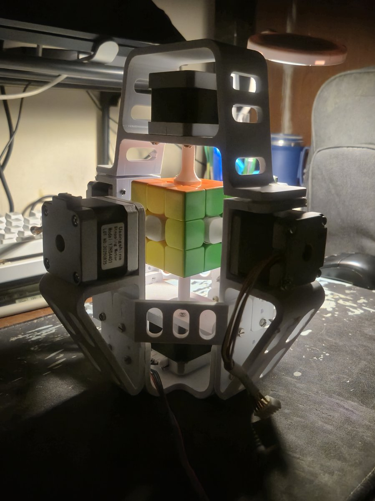
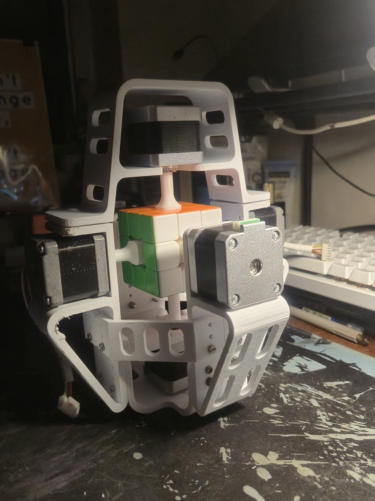

# cube_solver

Reads the full state of a 3x3 Rubik's cube from an ordinary webcam and solves it. You show the camera the cube's six faces. The program finds the face in each frame by itself, reads the colours, checks that the result is a cube that can exist, and plays the solution on a 3D model of your cube.

It works on stickered and stickerless cubes of different sizes. You don't line the cube up with a grid and you don't calibrate colours, and the background can be anything.

https://github.com/user-attachments/assets/dc097dc3-7157-4916-b3fd-fec03616e855

The clip shows a stickerless cube, a stickered cube and a small stickered cube scanned and solved. It ends with a cube that has one corner twisted by hand, which the program refuses to solve because that state can't be reached by turning.

## How it works

1. **Locate the face.** The grooves between the pieces are found in an edge map. A 3x3 grid is fitted to them and snapped onto the strongest lines, and Lucas-Kanade optical flow keeps it locked while the cube moves. Every 3x3 has grooves, stickered or not.
2. **Read the colours.** Each face is warped upright, and the centre of every facelet is sampled in LAB colour space.
3. **Resolve the colours.** All 54 readings are matched to the cube's 26 physical pieces at once, using the six centres as the reference. The cube serves as its own colour chart, which is why no calibration is needed.
4. **Check legality.** The program checks sticker counts, corner twist, edge flip and permutation parity. If a check fails, it names the condition that failed and gives no solution.
5. **Solve and show.** Kociemba's two-phase algorithm finds the solution, which plays on a 3D cube drawn with Ursina.

## The robot

<p>
  
  
</p>

Six stepper motors grip the cube, one on each centre. The frame and motors are built. The robot node that drives them is not written yet. On the ROS 2 side it will replace the stand-in executor described below.

## Repository layout

```
vision/   Python package: OpenCV, NumPy, Ursina, kociemba. No ROS dependency
ros/      ROS 2 Jazzy packages that wrap the vision package for the robot
```

## Quick start

Requires Python 3.12, [uv](https://docs.astral.sh/uv/) and a webcam.

```bash
cd vision
uv sync
uv run python -m cube_solver.window 0     # 0 is the camera index
```

While scanning, SPACE reads a face once the grid is locked, U undoes, N starts a new scan and D shows the tracker's numbers. After the sixth face, SPACE plays the solution and RIGHT / LEFT step through it. Add `--mirror` if your camera mirrors the image.

## Tests

```bash
cd vision
uv run pytest       # with ROS sourced in the shell: env -u PYTHONPATH uv run pytest
```

## ROS 2

`ros/` runs the scan, the solve and the 3D view as ROS 2 nodes, with a stand-in executor in place of the robot. Setup, build and launch instructions are in [ros/README.md](ros/README.md).

## Status

Done and tested: scanning, colour resolution, the legality check, solving, the single window and the ROS 2 chain. Next: the robot node, and having the robot scan the cube with its own camera.
