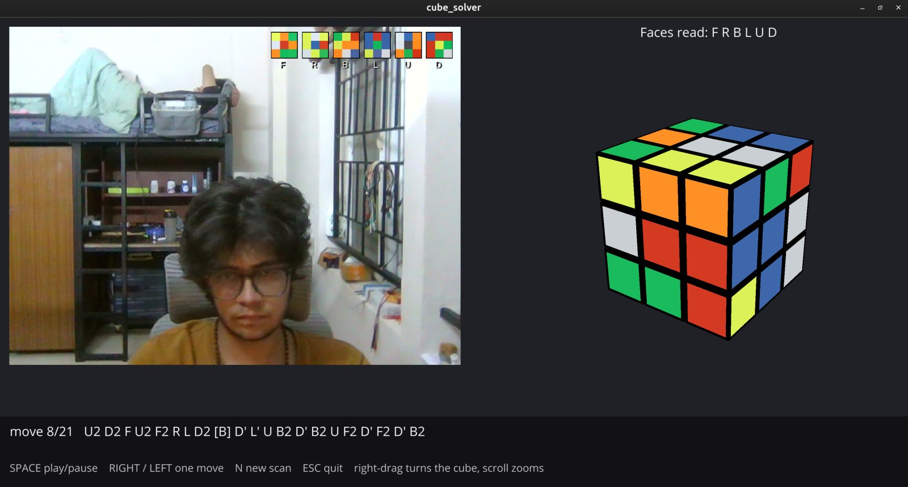

# cube_solver

Reads the full state of a 3x3 Rubik's cube from an ordinary webcam and solves it. You hold the cube up to the camera and show its six faces; the program finds the face in each frame by itself, reads the nine colours, works out which face every sticker belongs to, checks that the result is a cube that can exist, and plays the solution on a 3D model of your cube in its own colours.

It works on stickered and stickerless cubes, needs no manual grid alignment and no colour calibration, and runs in front of an arbitrary background.



## How it works

1. **Locate the face.** The grooves between pieces are found in an edge map, a 3x3 grid is fitted to them and snapped onto the strongest lines, and Lucas-Kanade optical flow keeps it locked while the cube moves. Every 3x3 has grooves, stickered or not, so nothing has to be lined up by hand.
2. **Read the colours.** Each face is warped upright and the centre of every sticker is sampled in LAB colour space.
3. **Resolve the colours.** The 54 readings are matched to the cube's 26 physical pieces all at once, with the six centres as the reference, so the cube acts as its own colour chart and no calibration is needed.
4. **Check legality.** Sticker counts, corner twist, edge flip and permutation parity are checked, and a failed check names the condition that failed instead of producing a wrong solution.
5. **Solve and show.** Kociemba's two-phase algorithm gives the solution, which plays on a 3D cube drawn with Ursina.

## Repository layout

```
vision/   plain Python package (OpenCV, NumPy, Ursina, kociemba), no ROS dependency
ros/      ROS 2 Jazzy packages that wrap the vision package for a robot
```

## Quick start

Requires Python 3.12, [uv](https://docs.astral.sh/uv/) and a webcam.

```bash
cd vision
uv sync
uv run python -m cube_solver.window 0        # the single window; 0 is the camera index
```

SPACE reads a face once the grid is locked, U undoes, N starts a new scan, D shows the tracker's numbers. After the sixth face, SPACE plays the solution and RIGHT / LEFT step through it. Add `--mirror` if the camera delivers a mirrored image.

Run the tests from `vision/`:

```bash
uv run pytest        # if ROS is sourced in your shell: env -u PYTHONPATH uv run pytest
```

## ROS 2

`ros/` runs the scan, the solve and the 3D view as ROS 2 nodes, with a stand-in executor in place of the robot. Setup, build and launch instructions are in [ros/README.md](ros/README.md).

## Status

Scanning, colour resolution, solving, the single window and the ROS 2 chain work and are tested. Next is the robot that turns the cube and scans it with its own camera.
